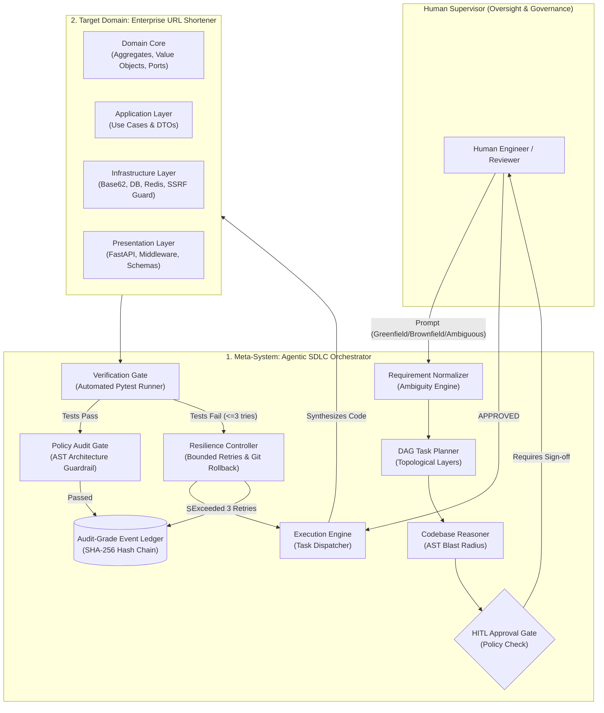
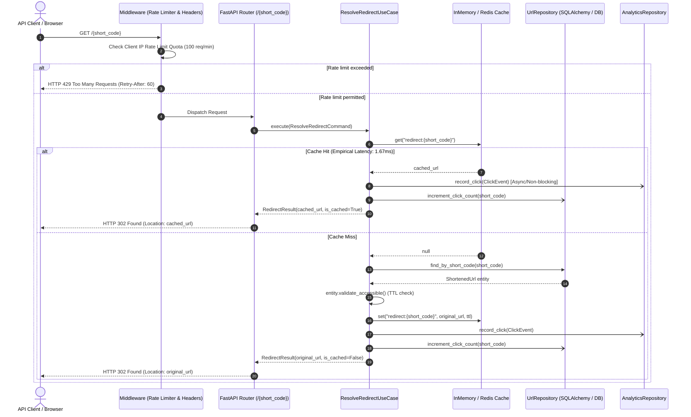
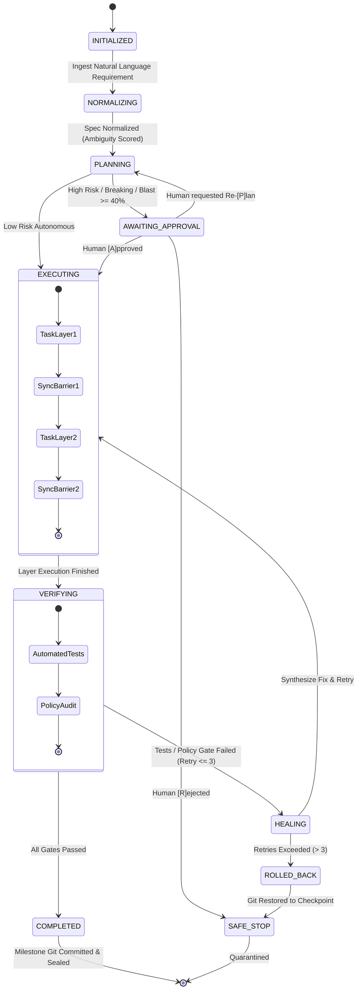
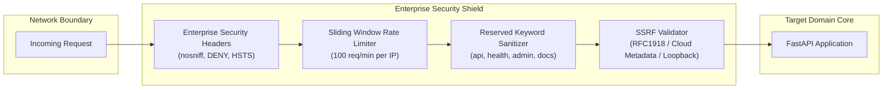

# Enterprise System Architecture Blueprint: Agentic Software Engineering System
**Document Version:** 1.0.0  
**Role:** Staff AI Systems Engineer & Enterprise Solutions Architect  
**Classification:** Financial Enterprise Grade (Schwab Internal Standard Compliance)  
**Status:** Living Engineering Architecture Contract  

---

## 1. Executive Architecture Summary

This system represents a production-grade implementation of an **Agentic Software Engineering System** applied to an **Enterprise URL Shortener Service**. 

The core thesis of this architecture is **Controlled Autonomy**:
> *"Agents execute multi-step work under defined autonomy boundaries; humans own oversight, approvals, and final quality."*

Rather than relying on brittle linear prompt chains, the system strictly isolates:
1. **The Meta-System (Agentic SDLC Orchestration Engine):** A stateful, DAG-driven workflow engine with entry/exit transition gates, AST blast-radius impact analysis, bounded retries ($\le 3$), automated Git-backed rollback, human-in-the-loop (HITL) checkpoints, and an immutable SHA-256 hash-chained audit ledger.
2. **The Target Domain Service (Enterprise URL Shortener):** A Clean Architecture service featuring collision-resistant Base62 Snowflake ID generation, multi-tier persistence (SQLite/Postgres + Redis/Memory), financial-grade SSRF defense, sliding-window rate limiting, and time-series click analytics.

---

## 2. Target Domain Service Architecture (URL Shortener)

The URL shortener adheres strictly to **Clean / Hexagonal Architecture** ([ADR-001](file:///Users/niharikapasham/Documents/workspace/url-shortener/docs/adr/ADR-001_clean_architecture.md)), ensuring decoupling between business rules, database technologies, and transport layers.

### 2.1 Layer Breakdown & Responsibilities

```mermaid
graph TD
    subgraph Presentation ["Presentation Layer (HTTP / REST)"]
        API["FastAPI Routes (/api/v1/urls, /{code})"]
        MidSec["Security Headers Middleware"]
        MidRate["Sliding-Window Rate Limiter Middleware"]
        Schemas["Pydantic V2 Request / Response Schemas"]
    end

    subgraph Application ["Application Layer (Use Cases & DTOs)"]
        UC_Create["CreateShortUrlUseCase"]
        UC_Redirect["ResolveRedirectUseCase"]
        UC_Analytics["GetAnalyticsUseCase"]
        UC_Delete["DeleteUrlUseCase"]
        DTOs["Immutable Data Transfer Objects"]
    end

    subgraph Domain ["Domain Layer (Business Logic & Ports)"]
        Agg["ShortenedUrl Aggregate"]
        ClickEnt["ClickEvent Entity"]
        VO_Code["ShortCode Value Object"]
        VO_Url["OriginalUrl Value Object"]
        Port_Repo["UrlRepository (Port)"]
        Port_Analytics["AnalyticsRepository (Port)"]
        Port_Cache["CacheService (Port)"]
        Port_Rate["RateLimiterService (Port)"]
    end

    subgraph Infrastructure ["Infrastructure Layer (Adapters & Security)"]
        Base62["Base62 Snowflake Generator"]
        SSRF["SSRF Validator Guardrail"]
        DB_SQL["SqlAlchemyUrlRepository (SQLite / Postgres)"]
        DB_Mem["InMemoryUrlRepository (High-Speed Test)"]
        Cache_Redis["Redis / InMemoryCacheService"]
        Rate_Mem["SlidingWindowRateLimiter"]
    end

    API --> UC_Create & UC_Redirect & UC_Analytics & UC_Delete
    UC_Create & UC_Redirect & UC_Analytics & UC_Delete --> Agg & VO_Code & VO_Url
    UC_Create & UC_Redirect & UC_Analytics & UC_Delete --> Port_Repo & Port_Analytics & Port_Cache & Port_Rate
    DB_SQL & DB_Mem -.->|Implements| Port_Repo & Port_Analytics
    Cache_Redis -.->|Implements| Port_Cache
    Rate_Mem -.->|Implements| Port_Rate
    UC_Create --> SSRF & Base62
```

### 2.2 Core Invariants & Value Objects
- **`ShortCode` ([`value_objects.py#L26`](file:///Users/niharikapasham/Documents/workspace/url-shortener/src/url_shortener/domain/value_objects.py#L26)):** Validated regex `^[a-zA-Z0-9_-]{3,64}$`. Strictly forbids reserved system slugs (`api`, `health`, `metrics`, `admin`, `docs`).
- **`OriginalUrl` ([`value_objects.py#L48`](file:///Users/niharikapasham/Documents/workspace/url-shortener/src/url_shortener/domain/value_objects.py#L48)):** RFC 3986 parseable, schemes strictly `http` or `https`, maximum length 2048 characters, network host required.
- **`ShortenedUrl` ([`models.py#L12`](file:///Users/niharikapasham/Documents/workspace/url-shortener/src/url_shortener/domain/models.py#L12)):** Encapsulates TTL expiration verification and state transitions.

### 2.3 High-Throughput Redirect Sequence (Cache-Aside Pattern)

---

## 3. Meta-System Architecture: Agentic SDLC Orchestration Engine

The Agentic Orchestration Engine is a non-linear, stateful SDLC workflow manager designed for controlled autonomy in enterprise environments.

### 3.1 Finite State Machine (FSM)

### 3.2 Dynamic DAG Task Decomposition with Parallel Layers
Tasks are decomposed into an explicit Directed Acyclic Graph ([`src/orchestrator/dag.py`](file:///Users/niharikapasham/Documents/workspace/url-shortener/src/orchestrator/dag.py)). The topological sorter identifies independent branches and groups them into parallel execution layers separated by synchronization barriers:

- **Layer 1:** Requirement Normalization Gate (`task_req_norm`)
- **Layer 2:** Architecture & Interface Contract Design (`task_arch_design`)
- **Layer 3:** Codebase AST Impact Analysis (`task_impact_analysis` for brownfield)
- **Layer 4:** Governance & HITL Sign-off (`task_hitl_checkpoint`)
- **Layer 5 (Parallel Execution):**
  - Branch A: Domain Core & Use Cases (`task_impl_domain`)
  - Branch B: Infrastructure & Persistence Adapters (`task_impl_infra`)
- **Synchronization Barrier:** Join Layer 5 branches
- **Layer 6:** Presentation & REST API Scaffolding (`task_impl_presentation`)
- **Layer 7:** Automated Verification Gate (`task_verify_tests`)
- **Layer 8:** Security & Clean Architecture Policy Gate (`task_policy_audit`)
- **Layer 9:** Release Readiness & Audit Ledger Sealing (`task_release_readiness`)

### 3.3 Dynamic Re-planning on Upstream Changes
When an upstream task changes schema definitions or fails a precondition, `TaskGraph.replan(failed_node_id, replacement_nodes)`:
1. Performs depth-first traversal to identify all downstream dependents.
2. Invalidates downstream completed states, resetting them to `PENDING`.
3. Slices in replacement nodes with updated dependencies.
4. Verifies no cyclic dependencies before resuming execution.

---

## 4. Security & Compliance Architecture (Financial Enterprise Standard)

The system enforces defense-in-depth security matching Schwab Internal guidelines:

### 4.1 SSRF Prevention Engine ([`ssrf.py`](file:///Users/niharikapasham/Documents/workspace/url-shortener/src/url_shortener/infrastructure/security/ssrf.py))
- Validates every destination URL before saving.
- Rejects RFC 1918 subnets (`10.0.0.0/8`, `172.16.0.0/12`, `192.168.0.0/16`).
- Rejects IPv4/IPv6 loopback (`127.0.0.0/8`, `::1`).
- Rejects cloud instance metadata (`169.254.169.254`, `100.100.100.200`, `fd00:ec2::254`).
- Rejects internal DNS namespaces (`.internal`, `.local`, `.localhost`).
- Rejects non-HTTP schemes (`file://`, `ftp://`, `gopher://`).

### 4.2 AST Code Policy Guardrail ([`governance.py`](file:///Users/niharikapasham/Documents/workspace/url-shortener/src/orchestrator/governance.py))
- Prior to committing any synthesized code, the orchestrator inspects the Python Abstract Syntax Tree.
- Prohibits dangerous calls: `eval()`, `exec()`.
- Prohibits unauthorized modules: `pickle`, `telnetlib`.
- Enforces Clean Architecture: verifies `src/url_shortener/domain/` never imports from `presentation` or `infrastructure`.

---

## 5. Failure Mode and Effects Analysis (FMEA) & Risk Register

| Failure Mode | Root Cause | Severity (1-10) | Occurrence (1-10) | Detection (1-10) | RPN | Automated Mitigation & Control Mechanism |
|---|---|---|---|---|---|---|
| **SSRF Internal Reconnaissance** | Hostile client submits URL targeting internal cloud metadata (`169.254.169.254`) | 9 | 4 | 2 | **72** | [`SSRFValidator`](file:///Users/niharikapasham/Documents/workspace/url-shortener/src/url_shortener/infrastructure/security/ssrf.py) inspects IP literals and DNS resolutions; blocks immediately with HTTP 403. |
| **Short Code Collision Storm** | Extreme traffic spikes causing identical slug generation | 7 | 2 | 2 | **28** | 64-bit Snowflake timestamp+node+seq bit layout guarantees zero collisions ($595\text{k codes/sec}$). |
| **Silent API Breaking Change** | Agent alters route parameter or return schema in brownfield code | 8 | 4 | 2 | **64** | [`CodebaseImpactAnalyzer`](file:///Users/niharikapasham/Documents/workspace/url-shortener/src/orchestrator/impact_analyzer.py) detects symbol delta; triggers mandatory HITL authorization checkpoint. |
| **Infinite Agent Healing Loop** | Agent produces code that fails tests, attempts self-healing repeatedly | 6 | 5 | 1 | **30** | [`ResilienceController`](file:///Users/niharikapasham/Documents/workspace/url-shortener/src/orchestrator/resilience.py) enforces strictly bounded $\le 3$ retries. If 3rd fails, triggers Git rollback and `SAFE_STOP`. |
| **Audit Ledger Forgery / Tampering** | Malicious actor modifies historical audit logs to conceal changes | 9 | 2 | 1 | **18** | SHA-256 hash-chaining across all JSONL records; `verify_integrity()` detects any byte alteration instantly. |
| **Denial of Service (DoS) / Flood** | Script floods redirect or shorten endpoint with thousands of requests | 7 | 5 | 2 | **70** | [`SlidingWindowRateLimiter`](file:///Users/niharikapasham/Documents/workspace/url-shortener/src/url_shortener/infrastructure/security/rate_limiter.py) throttles clients exceeding 100 req/min with HTTP 429 and `Retry-After`. |

---

## 6. Architecture Decision Records (ADRs) Index

| ADR ID | Title | Summary & Strategic Choice | File Link |
|---|---|---|---|
| **ADR-001** | Clean Architecture for Domain Service | Ports and adapters decoupling domain logic from databases and frameworks. | [ADR-001](file:///Users/niharikapasham/Documents/workspace/url-shortener/docs/adr/ADR-001_clean_architecture.md) |
| **ADR-002** | Base62 Snowflake ID Generation | 64-bit monotonic snowflake ID over random UUIDv4 ($595\text{k codes/sec}$, 0 collisions). | [ADR-002](file:///Users/niharikapasham/Documents/workspace/url-shortener/docs/adr/ADR-002_base62_snowflake_id_generation.md) |
| **ADR-003** | Stateful DAG-Based Orchestration | Non-linear DAG with parallel sync layers over brittle linear prompt chaining. | [ADR-003](file:///Users/niharikapasham/Documents/workspace/url-shortener/docs/adr/ADR-003_stateful_dag_orchestration.md) |
| **ADR-004** | Dual-Tier Autonomy & HITL Gate | Machine-speed autonomy for low-risk; mandatory human approval for high-risk changes. | [ADR-004](file:///Users/niharikapasham/Documents/workspace/url-shortener/docs/adr/ADR-004_dual_tier_autonomy_and_hitl.md) |
| **ADR-005** | Cryptographic SHA-256 Audit Ledger | Tamper-evident hash-chained append-only event ledger for full decision lineage. | [ADR-005](file:///Users/niharikapasham/Documents/workspace/url-shortener/docs/adr/ADR-005_cryptographic_audit_ledger.md) |
