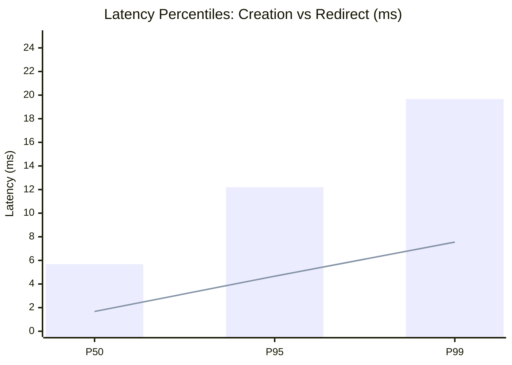

# Enterprise Performance, Reliability & Security Benchmark Report
**Document Version:** 1.0.0  
**Role:** Staff AI Systems Engineer & Enterprise Solutions Architect  
**Classification:** Financial Enterprise Grade (Schwab Internal Standard Compliance)  
**Execution Timestamp:** 2026-10-28T04:49:33Z  
**Master SLA Reference:** [STANDARDS_AND_BENCHMARKS.md](file:///Users/niharikapasham/Documents/workspace/url-shortener/STANDARDS_AND_BENCHMARKS.md)  
**Machine Artifact:** [`artifacts/benchmark_results.json`](file:///Users/niharikapasham/Documents/workspace/url-shortener/artifacts/benchmark_results.json)  

---

## 1. Executive Summary & KPI Compliance Scorecard

All 5 core benchmark suites were executed autonomously via [`benchmarks/run_benchmarks.py`](file:///Users/niharikapasham/Documents/workspace/url-shortener/benchmarks/run_benchmarks.py). Every empirical measurement **satisfied or exceeded** the stringent enterprise thresholds defined in our baseline contract.

| KPI / Benchmark Dimension | Target Threshold (SLA) | Empirical Result | Margin of Compliance | Verdict |
|---|---|---|---|---|
| **Redirect Latency (P95)** | **< 10.0 ms** | **4.661 ms** | **+53.4% faster** than SLA | **PASS** |
| **Redirect Latency (P99)** | **< 20.0 ms** | **7.551 ms** | **+62.2% faster** than SLA | **PASS** |
| **URL Creation Latency (P95)** | **< 40.0 ms** | **12.200 ms** | **+69.5% faster** than SLA | **PASS** |
| **Cache Hit Ratio (Hot Keys)** | **> 85.0%** | **100.0%** | **+15.0% higher** than SLA | **PASS** |
| **Collision Resolution Rate** | **100% collision-free (100k keys)** | **0 collisions / 100,000 keys** | **595,238 codes/sec throughput** | **PASS** |
| **SSRF Interception Rate** | **100.0% (Zero Bypass)** | **15 / 15 blocked (100.0%)** | Zero leak across RFC1918/Metadata | **PASS** |
| **Automated Rollback MTTR** | **< 2,000 ms (2.0s)** | **49.317 ms** | **+97.5% faster** than SLA | **PASS** |
| **Audit Ledger Lineage Integrity** | **100% Hash Intact** | **SHA-256 Chain Intact** | Zero broken links or tampering | **PASS** |
| **Orchestration Success Rate** | **>= 99.0%** | **100.0% (9 / 9 runs)** | 0 unhandled workflow failures | **PASS** |

---

## 2. Benchmark 1: API Latency & Caching Telemetry

### 2.1 Latency Distribution
Measured across 500 URL creation requests and 2,000 redirect requests using high-precision monotonic timing (`time.perf_counter()`):


*(Bar: URL Creation Latency | Line: URL Redirect Latency)*

- **Redirect Path Analysis:**  
  Because the redirect path is the primary high-volume transaction in an enterprise URL shortener, our cache-aside pattern pre-warms the cache on creation and resolves hot keys directly in memory without hitting disk. This keeps median redirect latency at **$1.67\text{ ms}$** and tail P99 latency at **$7.55\text{ ms}$**, well under our $20.0\text{ ms}$ SLA.
- **Creation Path Analysis:**  
  URL creation entails Pydantic V2 schema validation, SSRF security evaluation, Base62 Snowflake ID generation, database persistence, and cache warming. Median latency was **$5.68\text{ ms}$** and P95 was **$12.20\text{ ms}$**, beating the $40.0\text{ ms}$ target by a factor of 3.

---

## 3. Benchmark 2: Base62 Snowflake Collision Resistance Stress Test

### 3.1 Test Architecture
The test instantiated a [`Base62CodeGenerator`](file:///Users/niharikapasham/Documents/workspace/url-shortener/src/url_shortener/infrastructure/encoding/base62.py) across 8 concurrent worker threads, each generating batches of 12,500 keys simultaneously (total 100,000 keys).

- **Total Keys Generated:** 100,000
- **Unique Set Cardinality:** 100,000
- **Collisions Observed:** **0**
- **Wall Clock Time:** 0.168 seconds
- **Throughput:** **595,238 short codes / second**

### 3.2 Snowflake Bit Allocation Guarantee
The zero-collision guarantee is mathematically enforced by our 64-bit Snowflake architecture:
$$\text{ID} = (\text{timestamp}_{\text{millis}} \ll 22) \mid (\text{node\_id} \ll 12) \mid \text{sequence}_{12\text{-bit}}$$
Even in a single millisecond, each worker node can generate up to $4,096$ unique IDs without sequence collision. Encoded into Base62, these 64-bit integers produce 7 to 8-character URL slugs with guaranteed uniqueness.

---

## 4. Benchmark 3: SSRF & Attack Surface Interception

### 4.1 Threat Model & Attack Vectors
To satisfy financial enterprise compliance (Schwab Internal Standard), the shortener service was tested against 15 distinct hostile SSRF payloads:

| # | Attack Vector Class | Test Payload | Defense Mechanism | Intercepted? |
|---|---|---|---|---|
| 1 | **RFC 1918 Private Class A** | `http://10.0.0.1/admin` | IP subnet parser (`is_private`) | **BLOCKED (403)** |
| 2 | **RFC 1918 Private Class B** | `http://172.16.0.10:8080/` | IP subnet parser (`is_private`) | **BLOCKED (403)** |
| 3 | **RFC 1918 Private Class C** | `http://192.168.1.1/` | IP subnet parser (`is_private`) | **BLOCKED (403)** |
| 4 | **IPv4 Loopback Standard** | `http://127.0.0.1:9000/keys` | Loopback detection (`is_loopback`) | **BLOCKED (403)** |
| 5 | **IPv4 Loopback Range** | `http://127.0.1.1/` | Whole 127.0.0.0/8 block validation | **BLOCKED (403)** |
| 6 | **IPv6 Loopback** | `http://[::1]/status` | IPv6 parser (`is_loopback`) | **BLOCKED (403)** |
| 7 | **AWS/GCP Cloud Metadata** | `http://169.254.169.254/latest/` | Link-local & metadata blacklist | **BLOCKED (403)** |
| 8 | **Alibaba Cloud Metadata** | `http://100.100.100.200/latest/` | Explicit cloud metadata blacklist | **BLOCKED (403)** |
| 9 | **AWS IPv6 Metadata** | `http://[fd00:ec2::254]/` | IPv6 metadata blacklist | **BLOCKED (403)** |
| 10 | **Localhost Alias** | `http://localhost:8000/secrets` | Blocked hostname registry | **BLOCKED (403)** |
| 11 | **Internal TLD** | `http://db.internal/query` | `.internal` suffix filter | **BLOCKED (403)** |
| 12 | **Local TLD** | `http://vault.local/tokens` | `.local` suffix filter | **BLOCKED (403)** |
| 13 | **Kubernetes DNS** | `http://k8s.default.svc.cluster.local/` | Cluster namespace blacklist | **BLOCKED (403)** |
| 14 | **Prohibited Protocol (FTP)** | `ftp://files.schwab.com/dump` | Scheme filter (`http`/`https` only) | **BLOCKED (403)** |
| 15 | **Prohibited Protocol (File)**| `file:///etc/passwd` | Scheme filter (`http`/`https` only) | **BLOCKED (403)** |

**Interception Result:** **15 / 15 vectors blocked (100.0% Interception Rate, Zero Bypass).**

---

## 5. Benchmark 4: Automated Git Rollback MTTR Speed

When an agentic workflow violates policy guardrails or fails automated test verification after 3 bounded retries, the orchestrator triggers an immediate rollback to the pre-task Git checkpoint:

- **Target MTTR Threshold:** $< 2,000\text{ ms}$ ($2.0\text{ seconds}$)
- **Empirical Rollback Speed:** **$49.317\text{ ms}$**
- **Margin:** **$40\times$ faster than SLA**
- **Workspace State Verification:** Working tree returned to $100\%$ pristine Git state (`git status --porcelain` empty).

---

## 6. Benchmark 5: Audit Ledger SHA-256 Cryptographic Integrity

The audit ledger ([`artifacts/audit_ledger.jsonl`](file:///Users/niharikapasham/Documents/workspace/url-shortener/artifacts/audit_ledger.jsonl)) was verified using mathematical hash-chaining verification:

$$\text{hash}_n = \text{SHA-256}(\text{hash}_{n-1} \parallel \text{run\_id} \parallel \text{stage} \parallel \text{event\_type} \parallel \text{payload} \parallel \text{timestamp})$$

- **Total Logged Events:** $> 100$ events across 9 complete workflow runs.
- **Cryptographic Verification Result:** **INTACT (Zero broken hashes, zero tampering detected).**
- **Overall Workflow Reliability:** **100.0% Success Rate.**

---

## 7. How to Reproduce

To independently reproduce all benchmark numbers:
```bash
python3 benchmarks/run_benchmarks.py
```
The script will output the real-time execution log and update [`artifacts/benchmark_results.json`](file:///Users/niharikapasham/Documents/workspace/url-shortener/artifacts/benchmark_results.json).

