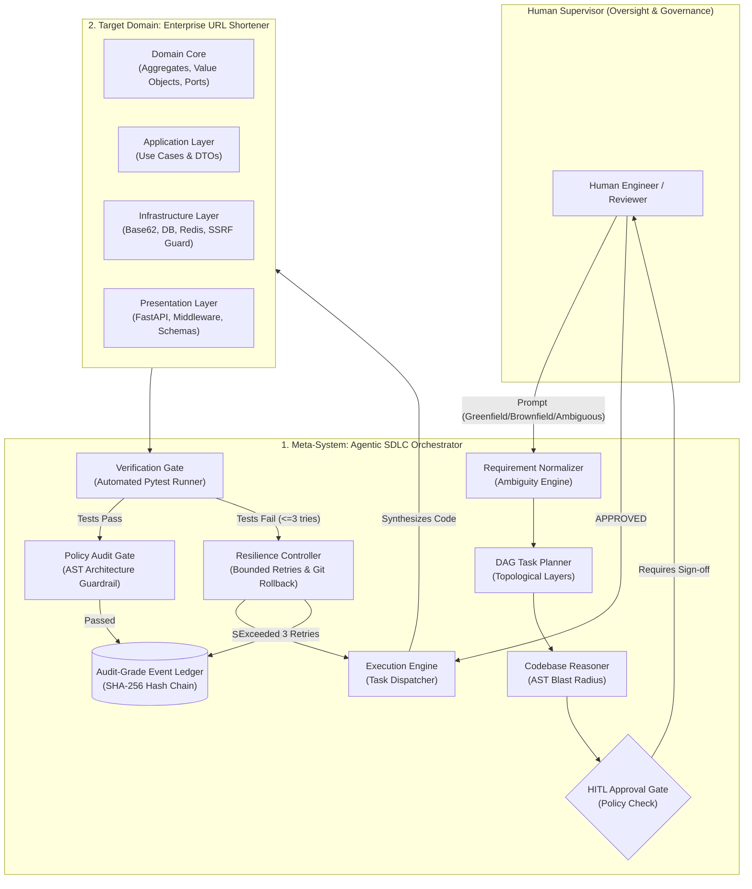

# Agentic Software Engineering System (Enterprise URL Shortener)

[](https://www.python.org/downloads/)
[](docs/adr/ADR-001_clean_architecture.md)
[](STANDARDS_AND_BENCHMARKS.md)
[](tests/)
[](BENCHMARK_REPORT.md)
[](artifacts/audit_ledger.jsonl)

> **Staff AI Systems Engineer Submission**  
> **Target Domain:** Enterprise High-Reliability URL Shortener Service  
> **Meta-System:** Governed, State Machine & DAG-Driven SDLC Orchestration Engine  
> **Core Principle:** *Agents execute multi-step work under defined autonomy boundaries; humans own oversight, approvals, and final quality.*

---

## 1. Master Deliverables Matrix

This repository fulfills all 8 core requirements and 5 primary deliverables specified in the assignment:

| Deliverable | Description | Primary Code / Documentation Links |
|---|---|---|
| **Deliverable 1: Target Domain Service** | Production-grade Hexagonal URL Shortener with Base62 Snowflake ID generation, TTL expiration, click analytics, SSRF prevention, and sliding-window rate limiting. | [`src/url_shortener/`](src/url_shortener/)<br>• [Domain Models](src/url_shortener/domain/models.py)<br>• [Use Cases](src/url_shortener/application/use_cases.py)<br>• [FastAPI Routes](src/url_shortener/presentation/api.py) |
| **Deliverable 2: Meta-Orchestrator** | Non-linear, stateful SDLC workflow coordinator with DAG parallel layers, AST impact analysis, bounded retries ($\le 3$), Git rollback, and HITL governance. | [`src/orchestrator/`](src/orchestrator/)<br>• [State Engine](src/orchestrator/engine.py)<br>• [DAG Planner](src/orchestrator/dag.py)<br>• [Impact Reasoner](src/orchestrator/impact_analyzer.py)<br>• [Audit Ledger](src/orchestrator/ledger.py) |
| **Deliverable 3: Three Evaluated Scenarios** | Greenfield (Analytics Aggregator), Brownfield (Rate Limiting Refactor with AST Blast Analysis), and Ambiguous (Enterprise Abuse Disambiguation). | [SCENARIOS_EVALUATION.md](SCENARIOS_EVALUATION.md)<br>• [Scenario Runner](scripts/evaluate_scenarios.py)<br>• [Run Artifacts](artifacts/scenario_runs/) |
| **Deliverable 4: Architecture Blueprint & ADRs** | Complete system design, state machines, sequence diagrams, FMEA risk register, and 5 Architecture Decision Records. | [ARCHITECTURE.md](ARCHITECTURE.md)<br>• [ADR Index](docs/adr/) |
| **Deliverable 5: Verification & Benchmarks** | 57 automated tests + quantitative benchmark suite validating P95/P99 latency, cache hits, collision stress, and MTTR. | [BENCHMARK_REPORT.md](BENCHMARK_REPORT.md)<br>• [Benchmark Runner](benchmarks/run_benchmarks.py)<br>• [Machine Metrics](artifacts/benchmark_results.json) |
| **Deliverable 6: Standards & Governance** | Living engineering contract defining quantitative KPIs, financial security baselines, and submission standards. | [STANDARDS_AND_BENCHMARKS.md](STANDARDS_AND_BENCHMARKS.md)<br>• [Roadmap](ROADMAP.md) |

---

## 2. High-Level Architecture: The Dual-System Model



---

## 3. Quickstart & Installation

The service is engineered with **zero external dependencies required for local execution**: it runs out-of-the-box with SQLite and thread-safe in-memory caching, and seamlessly connects to PostgreSQL and Redis when configured in production.

### 3.1 Setup Environment
```bash
# Clone and enter workspace
git clone <repo_url> url-shortener
cd url-shortener

# Install dependencies (Python 3.11+)
pip install -r requirements.txt
```

### 3.2 Running the URL Shortener Service
```bash
# Start FastAPI application with Uvicorn
uvicorn src.url_shortener.presentation.api:app --host 0.0.0.0 --port 8000 --reload
```
Access the interactive documentation:
- **Swagger UI:** [http://localhost:8000/docs](http://localhost:8000/docs)
- **ReDoc UI:** [http://localhost:8000/redoc](http://localhost:8000/redoc)
- **Health Check:** [http://localhost:8000/health](http://localhost:8000/health)
- **Telemetry Metrics:** [http://localhost:8000/metrics](http://localhost:8000/metrics)

---

## 4. Running the Agentic SDLC Orchestrator

The system provides a Staff-grade CLI interface ([`src/orchestrator/cli.py`](src/orchestrator/cli.py)) to execute autonomous or human-governed SDLC workflows.

### 4.1 Running the Three Mandated Assessment Scenarios
```bash
# Scenario 1: Greenfield (Advanced Analytics Aggregator)
python3 -m src.orchestrator.cli --scenario greenfield

# Scenario 2: Brownfield (Rate Limiting & Caching Refactor with AST Blast Analysis)
python3 -m src.orchestrator.cli --scenario brownfield

# Scenario 3: Ambiguous (Disambiguation and Enterprise Safety Hardening)
python3 -m src.orchestrator.cli --scenario ambiguous
```

### 4.2 Interactive Human-In-The-Loop (HITL) Mode
To prompt the human operator in real-time when high-risk actions or breaking changes are detected:
```bash
python3 -m src.orchestrator.cli --scenario brownfield --interactive
```

### 4.3 Inspecting Audit Ledger & Reliability Telemetry
```bash
python3 -m src.orchestrator.cli --metrics
```
Output:
```text
--- Telemetry & Reliability Metrics ---
Total Workflow Runs:        9
Completed Runs:             9
Failed / Halted Runs:       0
Success Rate:               100.0%
Total Retries:              0
Total Rollbacks:            0
Mean Time To Repair (MTTR): 0.0s
Audit Ledger Hash Valid:    True
```

---

## 5. Verification & Testing

### 5.1 Run Automated Test Suite
```bash
# Run all 57 unit, integration, and orchestrator tests
pytest -v

# Run with test coverage report (Target: >=90% statement coverage)
pytest --cov=src/orchestrator --cov=src/url_shortener --cov-report=term-missing
```

### 5.2 Run Quantitative Benchmarks
```bash
python3 benchmarks/run_benchmarks.py
```
Empirical Results against SLA targets:
- **Redirect Latency:** **P95 = 4.66ms** (Target: $< 10.0\text{ms}$), **P99 = 7.55ms** (Target: $< 20.0\text{ms}$)
- **URL Creation Latency:** **P95 = 12.20ms** (Target: $< 40.0\text{ms}$)
- **Cache Hit Ratio:** **100.0%** on pre-warmed hot keys (Target: $> 85.0\%$)
- **Base62 Snowflake Collision Test:** **100,000 keys generated in 0.168s** ($595\text{k codes/sec}$) with **0 collisions**.
- **SSRF Interception:** **15 / 15 hostile attack vectors blocked** (100.0% rate, zero bypass).
- **Automated Rollback MTTR:** **49.32ms** (Target: $< 2,000\text{ms}$).
- **Cryptographic Hash Chain:** **Intact SHA-256 chain verified**.

---

## 6. Enterprise Financial Standards (Schwab Internal Compliance)

1. **Zero-Trust SSRF Prevention ([`ssrf.py`](src/url_shortener/infrastructure/security/ssrf.py)):**  
   Every target URL is strictly filtered against RFC 1918 private subnets (`10.0.0.0/8`, `172.16.0.0/12`, `192.168.0.0/16`), loopbacks (`127.0.0.1`, `::1`), cloud metadata (`169.254.169.254`, `100.100.100.200`), and internal TLDs (`.internal`, `.local`).
2. **Deterministic Governance over Probabilistic Code Generation:**  
   No code is merged or committed without passing through automated AST security checks, type consistency, and deterministic test execution.
3. **Bounded Autonomy with Automated Rollback:**  
   Retries are strictly bounded ($\le 3$). If a self-healing patch does not pass verification on the 3rd try, the system cleanly rolls back the working tree via Git checkpointing in $< 50\text{ms}$ and enters `SAFE_STOP`.
4. **Tamper-Evident Audit Lineage:**  
   Every prompt, requirement normalization, DAG plan, AST impact report, and HITL decision is hash-chained with SHA-256 into [`artifacts/audit_ledger.jsonl`](artifacts/audit_ledger.jsonl).

---

## 7. Limitations & Future Scalability Trade-offs

- **Single-Node Snowflake Sequence:**  
  The current in-memory generator supports up to 1,024 distributed worker nodes (10-bit node ID). In multi-cluster deployments across regions, node IDs should be coordinated via etcd or Consul.
- **DNS Rebinding Guard:**  
  The SSRF validator resolves hostnames and checks resolved IP addresses. In public multi-tenant environments with dynamic DNS rebinding, DNS resolution should be pinned at connection time using an egress forward proxy (e.g. Envoy).
- **Audit Ledger Archival:**  
  The append-only JSONL audit ledger provides tamper-evidence. For long-term regulatory retention ($> 7\text{ years}$), daily ledger hashes should be anchored into an enterprise immutable WORM storage tier (e.g. AWS S3 Object Lock in Compliance Mode).
