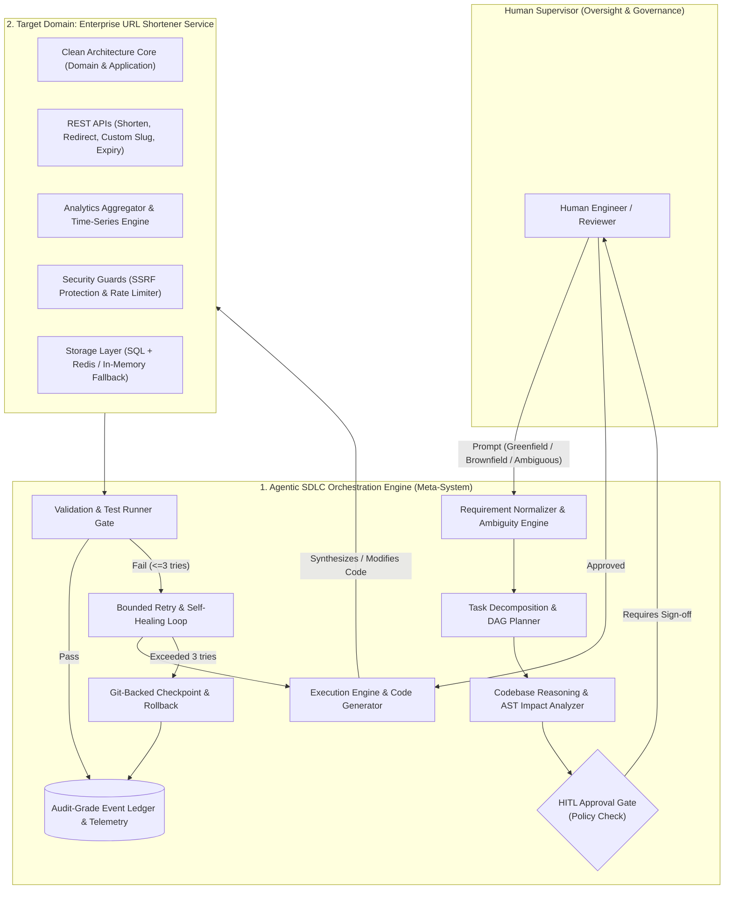
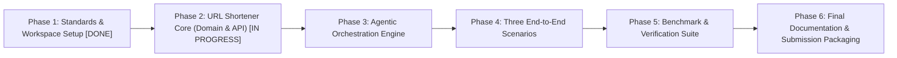

# Staff AI Engineer Master Deliverables Roadmap & Governance Plan

> **Classification:** Financial Enterprise Grade (Schwab Internal Standard Compliance)  
> **Key Principle:** Agents execute under defined autonomy boundaries; humans own oversight, approvals, and final quality.  
> **Reference Document:** [STANDARDS_AND_BENCHMARKS.md](file:///Users/niharikapasham/Documents/workspace/url-shortener/STANDARDS_AND_BENCHMARKS.md)

---

## 1. High-Level Architecture: The Dual-System Model

---

## 2. Assessment Requirement Breakdown & Technical Response

| # | Assessment Requirement | Staff AI Engineer Implementation Strategy | Primary Deliverable Artifact |
|---|---|---|---|
| **1** | **Requirement Understanding** | Ambiguity scoring algorithm, boundary validation, and transformation into a strict `NormalizedRequirementSpec`. | `orchestrator/normalizer.py` |
| **2** | **Task Decomposition** | Explicit Directed Acyclic Graph (DAG) construction with parallel branches, topological sort, and typed state transitions. | `orchestrator/planner.py` & `orchestrator/dag.py` |
| **3** | **Codebase Reasoning (Brownfield)** | AST parsing of Python source, symbol dependency graph, route registry inspection, and blast-radius impact analysis. | `orchestrator/impact_analyzer.py` |
| **4** | **Workflow Orchestration (Critical Differentiator)** | Stateful orchestration layer with entry/exit transition gates, context preservation, bounded retry loops ($\le 3$), automated Git rollback, and immutable audit logs. | `orchestrator/engine.py` & `orchestrator/ledger.py` |
| **5** | **Engineering Output Generation** | Production-grade Hexagonal URL Shortener: Base62 hashing, collision avoidance, TTL cleanup, click analytics, and strict type hints. | `src/url_shortener/` |
| **6** | **Validation & Risk Control** | SSRF prevention (blocking RFC1918/link-local/loopback), token bucket rate limiting, automated contract tests, and load benchmarks. | `src/url_shortener/infrastructure/security/` |
| **7** | **Controlled Autonomy** | Tiered autonomy matrix: autonomous execution for low-risk tasks, mandatory HITL checkpoints for breaking changes or schema migrations. | `orchestrator/governance.py` |
| **8** | **Final Engineering Summary** | Complete delivery suite: Architecture documentation, ADRs, risk register, test suites, and scenario walkthroughs. | `ARCHITECTURE.md`, `SCENARIOS_EVALUATION.md` |

---

## 3. The 6 Master Deliverables

### Deliverable 1: Target Domain - Production URL Shortener Service
- **Domain Layer:** Entities (`ShortenedUrl`, `ClickEvent`, `DomainPolicy`), Value Objects (`ShortCode`, `OriginalUrl`, `SlugType`), Domain Exceptions.
- **Application Layer:** Use cases (`CreateShortUrl`, `ResolveRedirect`, `GetAnalytics`, `EnforceRateLimit`).
- **Infrastructure Layer:** Dual-mode repository (SQLAlchemy + SQLite/Postgres), Redis caching with zero-dependency in-memory fallback, SSRF security filter.
- **Presentation Layer:** FastAPI application, OpenAPI 3.1 specs, standard error envelopes.

### Deliverable 2: Meta-System - Agentic Orchestration Engine
- **State Machine & DAG:** Typed states (`IDLE`, `PLANNING`, `AWAITING_APPROVAL`, `EXECUTING`, `VERIFYING`, `HEALING`, `COMMITTED`, `ROLLED_BACK`, `SAFE_STOP`).
- **Brownfield Analyzer:** Computes affected modules, public API breaking risk, and required test subsets.
- **Resilience Engine:** Max 3 retries with AST diff validation, automated Git commit on pass, automated `git reset` on failure.
- **Governance & HITL:** Interactive confirmation CLI for high-risk operations with policy rationale.
- **Telemetry:** Audit-grade JSONL event ledger tracking latency, MTTR, retry count, and success rate.

### Deliverable 3: Three End-to-End Evaluation Scenarios
- **Scenario A (Greenfield):** End-to-end generation of an Analytics Aggregation and Query feature.
- **Scenario B (Brownfield):** AST-guided enhancement adding sliding-window rate limiting and cache-aside redirect optimization.
- **Scenario C (Ambiguous):** Ingestion of vague prompt ("make URL shortener enterprise-safe"), automated ambiguity detection, interactive clarification, and governed execution.

### Deliverable 4: Architecture & Design Blueprint
- Comprehensive `ARCHITECTURE.md` with system diagrams, component interactions, and state transition matrices.
- Architecture Decision Records (`docs/adr/`) documenting key trade-offs (e.g., Base62 vs UUIDv4, DAG Orchestration vs Chaining, Sync vs Async analytics).

### Deliverable 5: Comprehensive Verification & Benchmark Suite
- Target domain test suite (`tests/domain/`, `tests/application/`, `tests/infrastructure/`, `tests/presentation/`) with $\ge 90\%$ coverage.
- Orchestrator verification suite (`tests/orchestrator/`) testing DAG transitions, retry bounds, rollback triggers, and HITL gates.
- Benchmark runner measuring P95/P99 latencies, cache hit ratios, and MTTR.

### Deliverable 6: Operational Runbook & Submission Bundle
- `README.md` with zero-dependency quickstart, Docker Compose instructions, and CLI command reference.
- Interactive runner script (`python -m orchestrator.cli run --scenario ...`).

---

## 4. Phase-by-Phase Implementation Plan

1. **Phase 1 (Completed):** Establish `STANDARDS_AND_BENCHMARKS.md`, initialize git repository, create directory hierarchy.
2. **Phase 2 (Current):** Build production-grade Clean Architecture URL Shortener (Base62, SQLite/Postgres, Redis/Memory cache, SSRF protection, Rate limiter, Analytics).
3. **Phase 3:** Build Agentic Orchestration Engine (DAG planner, AST brownfield analyzer, HITL governance, bounded retry, git rollback, audit ledger).
4. **Phase 4:** Execute and record the three mandatory scenarios (Greenfield, Brownfield, Ambiguous).
5. **Phase 5:** Run full benchmark suite, collect performance metrics (P95/P99 latency, MTTR, cache hit ratio), and verify test coverage $\ge 90\%$.
6. **Phase 6:** Generate `ARCHITECTURE.md`, `SCENARIOS_EVALUATION.md`, ADRs, and `README.md` with complete verification proofs.
