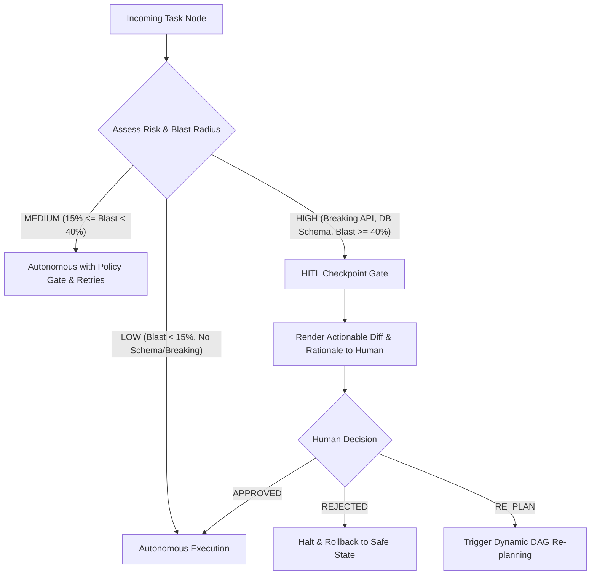

# ADR-004: Dual-Tier Autonomy & Human-In-The-Loop (HITL) Gate Design

**Status:** Accepted  
**Date:** 2026-10-28  
**Author:** Staff AI Systems Engineer  
**Classification:** Financial Enterprise Grade (Schwab Internal Standard Compliance)  

---

## 1. Context & Problem Statement
In financial institutions, completely autonomous AI agents pose severe risks: accidental database drops, silent API breaking changes, credential leaks, and compliance violations. Conversely, requiring human approval for every minor step (e.g. running linters, creating test boilerplate) creates fatigue and destroys engineering velocity.

The core principle mandated by the assessment is:
> *"Agents execute under defined autonomy boundaries; humans own oversight, approvals, and final quality."*

## 2. Decision
We implement a **Dual-Tier Controlled Autonomy Framework** enforced by [`GovernancePolicyEngine`](file:///Users/niharikapasham/Documents/workspace/url-shortener/src/orchestrator/governance.py):

### Autonomy Tiers Defined:
- **Tier 1 (Autonomous):** Formatting, scaffolding, domain aggregate generation, unit test creation, linting.
- **Tier 2 (Governed / HITL Required):**
  - Database schema alterations (`ALTER TABLE`, column drops).
  - Public REST API route modifications or breaking contract changes.
  - Security policy changes or credential configurations.
  - Any task where the AST Blast Radius Score exceeds $40\%$.

## 3. Human Approval Interface
When a task enters `AWAITING_APPROVAL`, the orchestrator displays:
1. Task ID, title, and risk tier.
2. AST blast-radius score ($0.0$ to $1.0$).
3. Target files and list of affected symbols.
4. Summary of proposed changes and regression test suite.
5. Interactive decision prompt: `[A]pprove`, `[R]eject`, or `Re-[P]lan`.

## 4. Consequences
- **Zero Accidental Outages:** Destructive changes cannot execute without cryptographic human sign-off in the audit ledger.
- **Velocity Maintained:** Routine tasks execute autonomously at machine speed.

